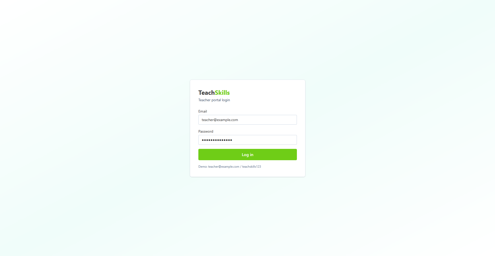
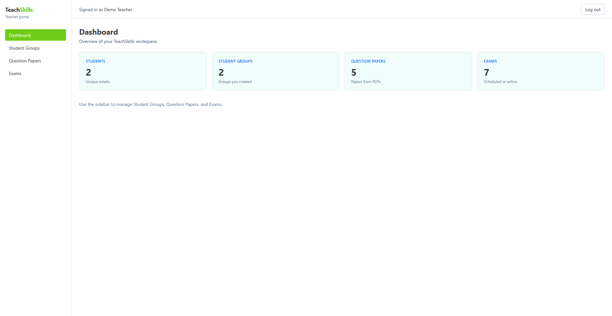
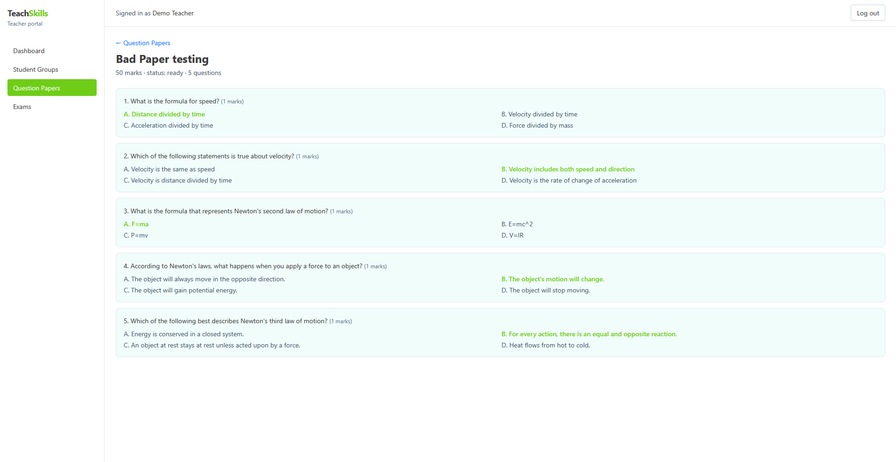
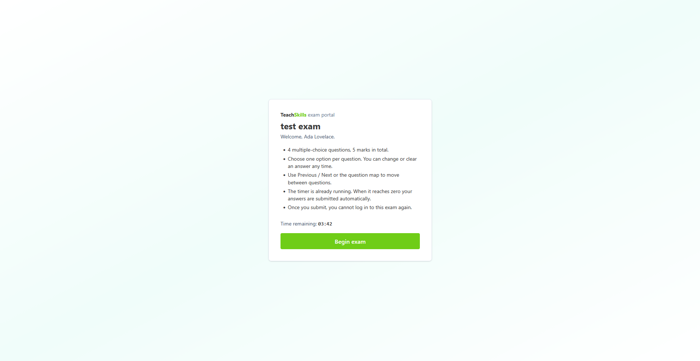
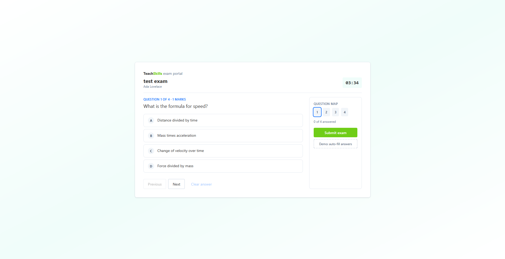
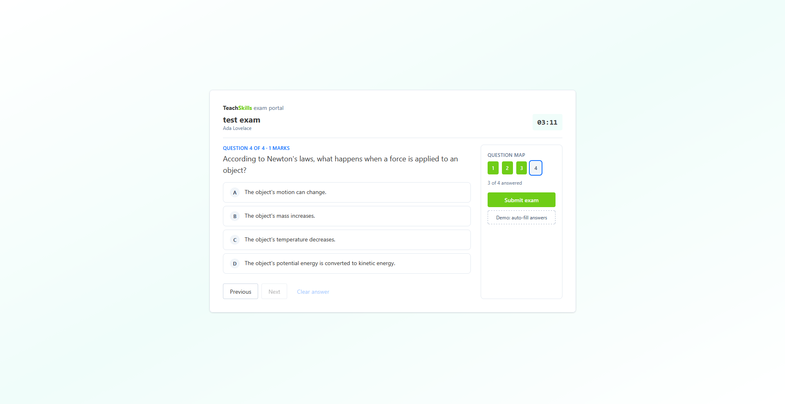
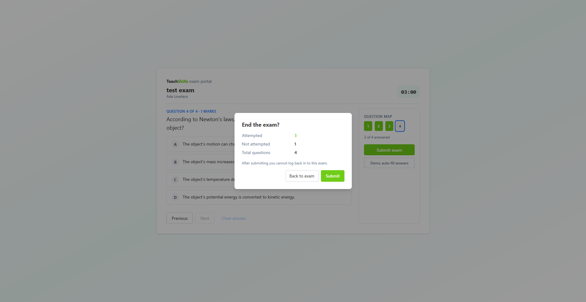
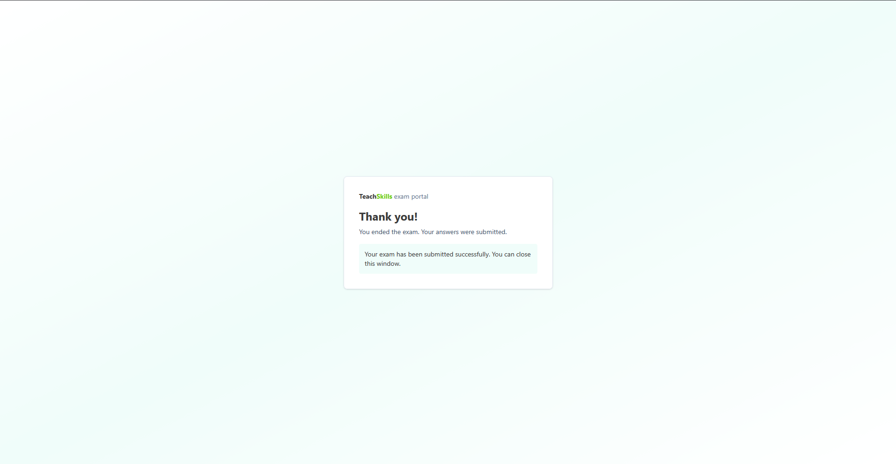
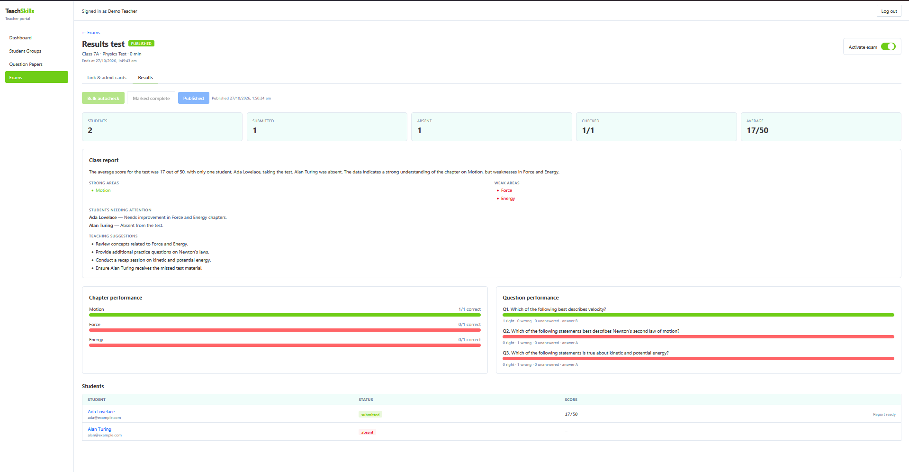

# TeachSkills

Teacher-focused exam platform for small tutors and coaching centres (Devpost Learn PoC).

An AI-assisted exam system for small private tutors and coaching centres. Motivation: quality education. When one teacher handles many students, most of them get overlooked, so the goal is to help teachers teach better and students improve.

## Project Screenshots

Flow is teacher portal → generated paper → student exam → published results.

### Teacher portal

**Login**



**Dashboard** — students, groups, papers, and exams at a glance



**Question paper** — AI-generated MCQs from a book PDF, with correct options marked



### Student exam portal

**Instructions** — welcome, rules, remaining time, then begin



**Taking the exam** — first question, question map, and timer



**In progress** — answered questions on the map, Previous / Next / Clear



**Submit** — confirm attempted vs unanswered, then submit (cannot log in again)



**Submitted**



### Results

**Published class report** — scores, absentees, chapter/question performance, and per-student report cards



## Stack

- `frontend/` — React (JSX), Tailwind CSS, axios
- `backend/` — Python FastAPI, JWT auth, MySQL
- AI — OpenAI `gpt-4o-mini` (later slices; configure via env)

## Prerequisites

- Node.js 20+
- Python 3.11+
- MySQL 8 (local install **or** Docker)

### MySQL via Docker

```bash
docker run -d --name teachskills-mysql ^
  -e MYSQL_ROOT_PASSWORD=root ^
  -e MYSQL_DATABASE=teachskills ^
  -e MYSQL_USER=teachskills ^
  -e MYSQL_PASSWORD=teachskills ^
  -p 3306:3306 mysql:8
```

Wait until MySQL is ready (first start can take ~30s).

## Setup

### Backend

```bash
cd backend
python -m venv .venv
.\.venv\Scripts\activate
pip install -r requirements.txt
copy .env.example .env
# edit .env if needed
uvicorn app.main:app --reload --port 8000
```

Run uvicorn from the `backend/` directory so `.env` and the `app` package resolve.

### Frontend

```bash
cd frontend
npm install
npm run dev
```

Open http://localhost:5173

## Demo teacher login

- Email: `teacher@example.com`
- Password: `teachskills123`

## Planning docs

Product and technical plans live in `devpost/` (learner profile is gitignored).
